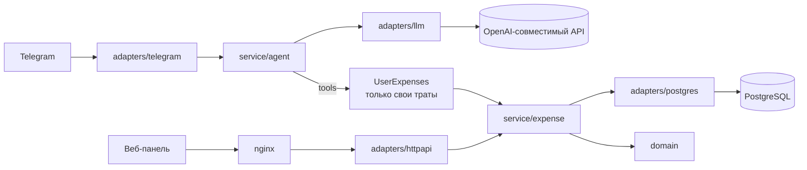

# Family Expenses: ИИ-бот учёта семейных расходов

[](https://github.com/ValievM/family-expense-bot/actions/workflows/ci.yml)

Член семьи пишет боту в Telegram обычным текстом: «кофе 350», «такси 1200 вчера». Бот сам определяет сумму, категорию и дату и сохраняет трату. Глава семьи видит траты всех в веб-панели и может их править.

- **Telegram-бот с ИИ-агентом.** Добавляет, показывает, изменяет и удаляет траты на естественном языке. Каждый видит только свои траты.
- **Веб-панель** (React). Список всех трат с фильтрами по члену семьи, периоду и категории, создание, правка, удаление. Авторизации нет по условию задания.
- **Бэкенд на Go**, PostgreSQL, всё запускается одной командой `docker compose`.

## Быстрый старт

Нужны Docker с Compose.

```bash
cp .env.example .env        # впишите TELEGRAM_BOT_TOKEN и LLM_API_KEY
docker compose up --build
```

Панель откроется на http://localhost:8080 (порт меняется переменной `WEB_PORT`).

Без `TELEGRAM_BOT_TOKEN` поднимутся база, REST API и панель, а бот будет отключён (это видно в логе). Так можно проверить панель без ключей.

Проверка собранного стека одной командой (создание, фильтр, изменение, удаление через nginx):

```bash
docker compose up -d --build --wait && scripts/smoke.sh
```

## Настройка (`.env`)

| Переменная | По умолчанию | Назначение |
|---|---|---|
| `TELEGRAM_BOT_TOKEN` | пусто | токен от @BotFather; пусто = бот выключен |
| `ALLOWED_USER_IDS` | пусто | Telegram ID через запятую, кому можно пользоваться ботом; пусто = всем |
| `LLM_BASE_URL` | `https://api.openai.com/v1` | любой OpenAI-совместимый API с tool calling |
| `LLM_API_KEY` | пусто | ключ; обязателен для OpenAI, для локальной Ollama не нужен |
| `LLM_MODEL` | `gpt-4.1-mini` | модель |
| `TZ` | `Europe/Moscow` | часовой пояс для «сегодня», «вчера» и дат трат |
| `WEB_PORT` | `8080` | порт панели на хосте |
| `POSTGRES_PASSWORD` | `expenses` | пароль БД внутри compose (наружу порт БД не открыт) |

**Другая модель или провайдер без правок кода.** Например, локальная Ollama:

```env
LLM_BASE_URL=http://host.docker.internal:11434/v1
LLM_MODEL=qwen2.5:7b
```

Нужна модель с поддержкой вызова функций (tools).

## Как пользоваться ботом

| Что написать | Что произойдёт |
|---|---|
| «кофе 350» | трата 350 ₽, категория «еда», дата сегодня |
| «такси 1200 вчера» | 1200 ₽, «транспорт», вчерашняя дата |
| «сколько потратил на еду в этом месяце» | сумма за месяц считается кодом, не моделью |
| «покажи траты за неделю» | список за последние дни |
| «последнее было не 350, а 450» | агент находит последнюю трату и меняет сумму |
| «удали такси» | находит трату; если подходит несколько, уточняет, какую |

Кнопок и команд нет, кроме автоматического `/start` с подсказкой.

## REST API

Контракт: [docs/openapi.yaml](docs/openapi.yaml). Суммы в API всегда целые числа копеек, даты в формате `YYYY-MM-DD`, ошибки в едином JSON `{"error":{"code","message"}}`.

| Метод | Путь | Описание |
|---|---|---|
| GET | `/api/expenses?user_id=&category=&from=&to=` | список с фильтрами, новые сверху |
| POST | `/api/expenses` | создать трату любому члену семьи |
| PATCH | `/api/expenses/{id}` | частичное изменение |
| DELETE | `/api/expenses/{id}` | удалить |
| GET | `/api/users` | члены семьи, у которых есть траты |
| GET | `/api/categories` | закрытый список категорий с русскими названиями |
| GET | `/healthz` | проверка живости |

## Архитектура

Ports and adapters (hexagonal): зависимости направлены только внутрь, `adapters → service → domain`.

```
cmd/server/            точка входа и единственное место сборки зависимостей
internal/
  domain/              Expense, Category, дата, ошибки, валидация (только stdlib)
  service/
    expense/           сценарии (use cases), порт Repository, привязка к владельцу
    agent/             ИИ-агент: инструменты, цикл, промпт, порт LLM
  adapters/
    postgres/          Repository на pgx + миграции goose
    httpapi/           REST на net/http (ServeMux), DTO, соответствие ошибок статусам
    llm/               клиент OpenAI-совместимого API, авторизация через Authorizer
    telegram/          long polling, очередь сообщений по пользователям
  config/              переменные окружения с проверкой при старте
web/                   React + TypeScript + Vite, раздаётся nginx
```



### Паттерны и принципы: где посмотреть

| Что | Где | Зачем |
|---|---|---|
| **Изоляция пользователей по конструкции** | `service/expense/user_expenses.go`, `service/agent/user_expenses.go` | `service.ForUser(id)` возвращает тип без параметра владельца; агент получает только интерфейс `UserExpenses`, неограниченных методов у него нет. `user_id` берётся из Telegram и никогда не приходит от модели |
| **Защита от prompt injection** | `service/agent/tools.go` | аргументы инструментов разбираются строго (`DisallowUnknownFields`): лишнее поле `user_id` отклоняется, в схемах инструментов его нет; есть тесты |
| **Command / Strategy + реестр** | `service/agent/tools.go`, `tool_*.go` | новый инструмент = новый тип `Tool`, цикл агента не меняется (OCP) |
| **Repository** | `service/expense/repository.go`, `adapters/postgres` | сервис знает только интерфейс (DIP); интерфейс объявляет потребитель |
| **Adapter** | `adapters/llm`, `adapters/telegram` | внешние API спрятаны за маленькими интерфейсами (ISP) |
| **Functional options** | `agent.New`, `llm.NewClient`, `telegram.NewBot` | настройка без раздутых конструкторов |
| **Внедрение зависимостей вручную** | `cmd/server/main.go` | без DI-фреймворков, всё видно в одном месте |
| **Таблица правил ошибок** | `adapters/httpapi/errors.go` | новая бизнес-ошибка = одна строка в таблице |
| **Единый источник категорий** | `domain/category.go` | из него берутся валидация, enum в схемах инструментов, промпт, `/api/categories`, фронтенд |
| **Внедряемые часы** | `service/expense/clock.go` | детерминированные тесты и «сегодня» в нужном часовом поясе |
| **DRY** | один `expense.Service` | REST и агент используют общие правила, частичное обновление (`Patch`) и значение даты по умолчанию |

Решения, которые стоит знать:

- **Деньги** хранятся как `BIGINT` в копейках, валюта одна (RUB); `float` в доменной логике нет. Рубли от модели переводятся в копейки с округлением в одном месте.
- **Итоги считает код.** Инструмент `list_expenses` возвращает готовую сумму и `latest_id`, модель не занимается арифметикой.
- **«Последняя трата»** это запись с наибольшим `id`, а не с наибольшей датой.
- **Память диалога** короткая, в оперативной памяти (8 сообщений на пользователя): хватает для «нет, 450» и уточнений «первое». После перезапуска сбрасывается.
- **Сообщения одного пользователя** обрабатываются строго по порядку (очередь на пользователя), разных пользователей параллельно.
- **Токен бота** не попадает в логи: ошибки транспорта очищаются от URL (есть тест).
- **Бот работает только в личных сообщениях**; в группах отвечает подсказкой.

## Разработка

```bash
make lint test            # gofmt, go vet, golangci-lint, юнит-тесты
make test-integration     # тесты репозитория на настоящем PostgreSQL (поднимает контейнер)
cd web && npm ci && npm run lint && npm run typecheck && npm test
```

Для разработки панели: `docker compose up -d db backend`, затем `cd web && npm run dev` (dev-сервер проксирует `/api` на `localhost:8080`; для этого опубликуйте порт бэкенда в локальном override-файле compose).

CI (GitHub Actions) прогоняет линтеры, тесты, интеграционный тест с PostgreSQL и сквозную проверку собранного compose-стека.

Каждая функция и метод в Go-коде снабжены комментарием в едином формате «Принимает / Делает / Возвращает».

### Как это тестировалось

- Агент: тесты с фейковой моделью и настоящим сервисом трат (добавление, итоги, правка «последней», удаление, чужие `id`, внедрение `user_id`, лимит шагов, память по пользователям).
- Telegram-бот: тесты с фейковым Bot API (доступ, личные чаты, порядок сообщений, скрытие внутренних ошибок, утечка токена).
- REST: `httptest`, соответствие ошибок статусам; репозиторий: интеграционные тесты на PostgreSQL 16.
- Собранный compose-стек: `scripts/smoke.sh`.

Живой запуск с настоящими токенами Telegram и LLM в автоматические проверки не входит: ему нужны ваши секреты.

## Вход через аккаунт OpenAI

Заложена возможность второго способа авторизации к LLM: клиент принимает интерфейс `Authorizer` (`adapters/llm/auth.go`), сейчас реализован ключ API. Вход «через ChatGPT» не реализован осознанно: по официальной документации OpenAI он доступен выбранным партнёрам по заявке, а имитация токенов Codex CLI не поддерживается. Если доступ появится, достаточно добавить реализацию `Authorizer` и переключатель в конфиге, остальной код не изменится.

## Как использовались ИИ-ассистенты

- **Claude Code** выступал техническим лидом: написал ТЗ ([docs/TZ.md](docs/TZ.md)) с задачами и зависимостями, провёл ревью каждой задачи (повторный запуск проверок, чтение диффа), реализовал агента, REST, LLM-клиент, бота, сборку и запуск, а на механических и независимых частях параллелил субагентов (комментарии по пакетам, веб-панель).
- **Codex** реализовал первые задачи (каркас, домен, сервис, PostgreSQL) по правилам из [AGENTS.md](AGENTS.md): одна задача за раз, отчёт в фиксированном формате, остановка до ревью.
- Все замечания ревью и их исправления видны в истории коммитов (Conventional Commits).
