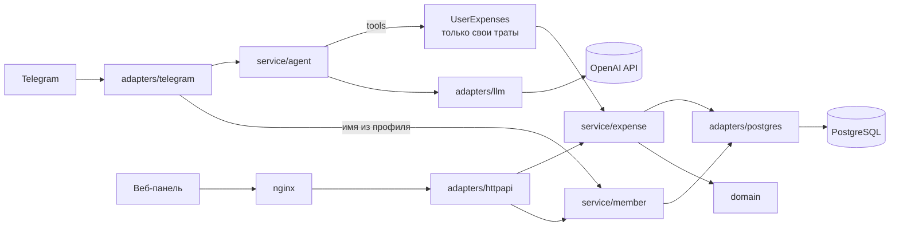

# Family Expenses: ИИ-бот учёта семейных расходов

[](https://github.com/ValievM/family-expense-bot/actions/workflows/ci.yml)

Член семьи пишет боту в Telegram обычным текстом: «кофе 350», «такси 1200 вчера». Бот сам определяет сумму, категорию и дату и сохраняет трату. Глава семьи видит траты всех в веб-панели и может их править.

- **Telegram-бот с ИИ-агентом.** Добавляет, показывает, изменяет и удаляет траты на естественном языке. Каждый видит только свои траты.
- **Веб-панель** (React). Список всех трат, сгруппированный по дням, с фильтрами по члену семьи, периоду и категории, создание, правка, удаление, светлая и тёмная темы, адаптивная вёрстка. Авторизации нет по условию задания.
- **Бэкенд на Go**, PostgreSQL, всё запускается одной командой `docker compose`.

## Быстрый старт

Нужны Git и Docker с Compose.

```bash
git clone https://github.com/ValievM/family-expense-bot.git
cd family-expense-bot
```

Настройки лежат в файле `.env`:

- **Если автор прислал готовый `.env`**, просто положите его в эту папку (рядом с `docker-compose.yml`).
- **Иначе** создайте его из шаблона и впишите свои значения (токен бота от [@BotFather](https://t.me/BotFather) и ключ модели; подробности в таблице ниже):

```bash
cp .env.example .env
```

Запуск:

```bash
docker compose up --build
```

Панель откроется на http://localhost:8080 (порт меняется переменной `WEB_PORT`), бот начнёт отвечать в Telegram. Остановить: `Ctrl+C`, а удалить контейнеры вместе с базой: `docker compose down -v`.

Без `TELEGRAM_BOT_TOKEN` поднимутся база, REST API и панель, а бот будет отключён (это видно в логе). Так можно проверить панель без ключей.

## Как открыть интерфейс

Интерфейса два, оба работают сразу после запуска.

**Веб-панель** (для главы семьи): откройте в браузере **http://localhost:8080** (если меняли `WEB_PORT`, то с вашим портом). Вход не нужен.

- Список трат сгруппирован по дням, сверху общая сумма. Фильтры: член семьи, категория, период (есть быстрые «этот месяц», «неделя» и другие).
- Кнопка **«Добавить трату»** создаёт трату любому члену семьи; клик по строке открывает правку, там же удаление.
- Переключатель светлой и тёмной темы в правом верхнем углу.
- Сразу после запуска список пуст: траты появляются, когда кто-то пишет боту или добавляет их вручную. Имена людей подтягиваются из Telegram после их первого сообщения боту.

**Telegram-бот**: найдите бота по имени и нажмите «Запустить» (Start), он пришлёт подсказку; дальше пишите траты обычным текстом. Имя бота показывает @BotFather. Если у вас есть только токен, имя можно получить так (поле `username` в ответе), и бот откроется по ссылке `https://t.me/<username>`:

```bash
curl https://api.telegram.org/bot<токен>/getMe
```

Проверка собранного стека одной командой (создание, фильтр, изменение, удаление через nginx):

```bash
docker compose up -d --build --wait && scripts/smoke.sh
```

## Настройка (`.env`)

| Переменная | По умолчанию | Назначение |
|---|---|---|
| `TELEGRAM_BOT_TOKEN` | пусто | токен от @BotFather; пусто = бот выключен |
| `ALLOWED_USER_IDS` | пусто | Telegram ID через запятую, кому можно пользоваться ботом; пусто = всем |
| `LLM_BASE_URL` | `https://api.z.ai/api/paas/v4` | любой OpenAI-совместимый API с вызовом функций (tools) |
| `LLM_API_KEY` | пусто | ключ; обязателен для облачных сервисов, для локальной Ollama не нужен |
| `LLM_MODEL` | `glm-5.3-flash` | модель |
| `TZ` | `Europe/Moscow` | часовой пояс для «сегодня», «вчера» и дат трат |
| `WEB_PORT` | `8080` | порт панели на хосте |
| `POSTGRES_PASSWORD` | `expenses` | пароль БД внутри compose (наружу порт БД не открыт) |

**Минимальный `.env`** (значения в `<...>` ваши):

```env
TELEGRAM_BOT_TOKEN=<токен от @BotFather>
LLM_API_KEY=<ключ>
```

Всё остальное необязательно и имеет значения по умолчанию из таблицы выше (по умолчанию GLM `glm-5.3-flash`). `DATABASE_URL`, `HTTP_ADDR` и пароль базы compose задаёт сам. В `.env.example` те же строки и закомментированные необязательные.

**Другой провайдер или модель без правок кода**: достаточно добавить в `.env`:

```env
# ключ тарифа GLM Coding Plan
LLM_BASE_URL=https://api.z.ai/api/coding/paas/v4

# или OpenAI
LLM_BASE_URL=https://api.openai.com/v1
LLM_MODEL=gpt-4.1-mini

# или локальная Ollama (ключ не нужен)
LLM_BASE_URL=http://host.docker.internal:11434/v1
LLM_MODEL=qwen2.5:7b
```

Нужна модель с поддержкой вызова функций (tools).

## Как пользоваться ботом

| Что написать | Что произойдёт |
|---|---|
| «кофе 350» | трата 350 ₽, категория «еда», дата сегодня |
| «такси 1200 вчера» | 1200 ₽, «транспорт», вчерашняя дата |
| «сколько потратил на еду в этом месяце» | сумма за месяц считается кодом, не моделью |
| «покажи траты за неделю» | список за последние дни |
| «последнее было не 350, а 450» | агент находит последнюю трату и меняет сумму |
| «удали такси» | находит трату; если подходит несколько, уточняет, какую |

Кнопок и команд нет, кроме `/start` (и `/help`) с подсказкой: при запуске бот сам заполняет карточку (описание над кнопкой «Запустить», короткое описание, меню с `/start`).

**Приватность.** Чтобы в панели были имена вместо чисел, бот сохраняет в базе (таблица `members`) имя и `@username` из профиля Telegram тех, кто ему пишет. Больше ничего из профиля не хранится.

## REST API

Контракт: [docs/openapi.yaml](docs/openapi.yaml). Суммы в API всегда целые числа копеек, даты в формате `YYYY-MM-DD`, ошибки в едином JSON `{"error":{"code","message"}}`.

| Метод | Путь | Описание |
|---|---|---|
| GET | `/api/expenses?user_id=&category=&from=&to=` | список с фильтрами, новые сверху |
| POST | `/api/expenses` | создать трату любому члену семьи |
| PATCH | `/api/expenses/{id}` | частичное изменение |
| DELETE | `/api/expenses/{id}` | удалить |
| GET | `/api/users` | члены семьи: владельцы трат и все, кто писал боту (`user_id`, `name`, `username`) |
| GET | `/api/categories` | закрытый список категорий с русскими названиями |
| GET | `/healthz` | проверка живости и базы (503, если база не отвечает) |

## Архитектура

Ports and adapters (hexagonal). Все интерфейсы между слоями лежат в `internal/ports`; сервисы и адаптеры зависят только от `ports` и `domain`, а не друг от друга (адаптеры не импортируют ни одного сервиса, всё соединяется в `cmd/server`).

```
cmd/server/            точка входа и единственное место сборки зависимостей
internal/
  ports/               интерфейсы между слоями, их DTO и общие ошибки
  domain/              агрегат Expense, объекты-значения Money, Day, UserID, Comment, Category, Member (только stdlib)
  service/
    expense/           сценарии (use cases) над агрегатом, привязка к владельцу
    member/            каталог членов семьи: запоминает имена из Telegram
    agent/             ядро ИИ-агента: цикл, промпт, память диалога, набор инструментов
      tools/           инструменты агента (add/list/update/delete), подключаются в main
  adapters/
    postgres/          репозитории трат и членов семьи на pgx + миграции goose
    httpapi/           REST на net/http (ServeMux), DTO, соответствие ошибок статусам
    llm/               клиент Chat Completions (OpenAI-совместимый), интерфейс Authorizer
    telegram/          long polling, очередь сообщений по пользователям
    systemclock/       часы
  config/              переменные окружения с проверкой при старте
migrations/            SQL-миграции (goose)
scripts/               сквозная проверка собранного стека
web/                   React + TypeScript + Vite, раздаётся nginx
```



### Паттерны и принципы: где посмотреть

| Что | Где | Зачем |
|---|---|---|
| **DDD: объекты-значения и агрегат** | `domain/` | `Money`, `Day`, `UserID`, `Comment` неизменяемы и проверяются в конструкторах; `Expense` это корень агрегата с закрытыми полями: создаётся только через `NewExpense`/`Restore`, меняется только через `Apply`, поэтому невалидного расхода не существует. Правило владения (`OwnedBy`) тоже в домене |
| **Изоляция пользователей по конструкции** | `service/expense/user_expenses.go`, `ports.UserExpenses` | `service.ForUser(id)` возвращает тип без параметра владельца; агент получает только интерфейс `UserExpenses`, неограниченных методов у него нет. `user_id` берётся из Telegram и никогда не приходит от модели |
| **Защита от prompt injection** | `service/agent/tools/args.go` | аргументы инструментов разбираются строго (`DisallowUnknownFields`): лишнее поле `user_id` отклоняется, в схемах инструментов его нет; есть тесты |
| **Command / Strategy + реестр** | `service/agent/tool.go` (контракт и `ToolSet`), `service/agent/tools/` (реализации) | новый инструмент = новый тип `Tool`, цикл агента не меняется (OCP) |
| **Ports and adapters** | `ports/`, `adapters/*` | сервисы и адаптеры знают только интерфейсы из `ports` (DIP); реализацию подставляет `cmd/server` |
| **Repository** | `ports.ExpenseRepository`, `adapters/postgres` | один репозиторий на агрегат |
| **Adapter** | `adapters/llm`, `adapters/telegram` | внешние API спрятаны за маленькими интерфейсами (ISP) |
| **Functional options** | `agent.New`, `llm.NewClient`, `telegram.NewBot` | настройка без раздутых конструкторов |
| **Внедрение зависимостей вручную** | `cmd/server/main.go` | без DI-фреймворков, всё видно в одном месте |
| **Таблица правил ошибок** | `adapters/httpapi/errors.go` | новая бизнес-ошибка = одна строка в таблице |
| **Единый источник категорий** | `domain/category.go` | из него берутся валидация, enum в схемах инструментов, промпт, `/api/categories`, фронтенд |
| **Внедряемые часы** | `ports.Clock`, `adapters/systemclock` | детерминированные тесты и «сегодня» в нужном часовом поясе |
| **DRY** | один `expense.Service` | REST и агент используют общие правила, частичное обновление (`domain.Changes`) и значение даты по умолчанию |

## Разработка

```bash
make lint test            # gofmt, go vet, golangci-lint, юнит-тесты
make test-integration     # тесты репозитория на настоящем PostgreSQL (поднимает контейнер)
cd web && npm ci && npm run lint && npm run typecheck && npm test
```

Для разработки панели: `docker compose up -d db backend`, затем `cd web && npm run dev` (dev-сервер проксирует `/api` на `localhost:8080`; для этого опубликуйте порт бэкенда в локальном override-файле compose).

CI (GitHub Actions) прогоняет Go-линтеры и тесты, интеграционный тест с PostgreSQL, проверки фронтенда (lint, typecheck, тесты, сборка) и сквозную проверку собранного compose-стека.

Политика комментариев: у функций с логикой три строки «Принимает / Делает / Возвращает», у интерфейсов комментариев нет, у тестов одна строка «Проверяет: …».

### Как это тестировалось

- Агент: тесты с фейковой моделью и настоящим сервисом трат (добавление, итоги, правка «последней», удаление, чужие `id`, внедрение `user_id`, лимит шагов, память по пользователям).
- Telegram-бот: тесты с фейковым Bot API (доступ, личные чаты, порядок сообщений, скрытие внутренних ошибок, утечка токена).
- REST: `httptest`, соответствие ошибок статусам, `/healthz` при недоступной базе; репозитории (траты и члены семьи): интеграционные тесты на PostgreSQL 16.
- Домен: объекты-значения и агрегат (в том числе разбор рублей без `float`); фронтенд: логика подписей людей, групп по дням, периодов, ошибок API (Vitest).
- Собранный compose-стек: `scripts/smoke.sh`.

Живой запуск с настоящими токенами Telegram и LLM в автоматические проверки не входит: ему нужны ваши секреты.
